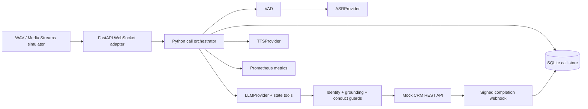

# ADR 0001: local voice-agent architecture

Status: accepted for the local portfolio prototype.

## Constraints and observations

Hardware observed in this WSL2 environment: NVIDIA GeForce RTX 4060 with 8 GiB VRAM (`nvidia-smi`); 4.8 GiB RAM (`free -h`); 16 logical CPUs (`nproc`); Python 3.13.12. Docker CLI is absent. Ollama 0.32.15 is installed. The original `rhasspy/piper` repository is archived; the maintained `OHF-Voice/piper1-gpl` fork is selected instead (GitHub API checked 2026-11-15). Real ASR/TTS evaluation is deferred until dependencies and voice artifacts are available and measured.

## Decision

Use a self-written FastAPI orchestration layer and explicit `ASRProvider`, `LLMProvider`, and `TTSProvider` contracts. Keep the deterministic Fake providers as the default local/CI path. Use SQLite for local call state and FastAPI WebSockets for audio transport. Place identity authorization and grounding checks in Python code, outside the prompt. Use a separate CRM HTTP service boundary in the final composition. Keep raw audio disabled by default.

The architecture diagram and audio boundary contract are below. Internal audio is mono 16 kHz signed 16-bit PCM; the telephony edge accepts 8 kHz G.711 mu-law and must resample before provider use. Twilio compatibility is a message-shape goal only; simulator-only checks cannot establish live Twilio interoperability.

## Official documentation checked

- FastAPI WebSockets: <https://fastapi.tiangolo.com/advanced/websockets/> (HTTP 200, checked 2026-11-15).
- `websockets` asyncio client API: <https://websockets.readthedocs.io/en/stable/reference/asyncio/client.html> (checked 2026-11-15).
- Ollama tool calling and thinking: <https://docs.ollama.com/capabilities/tool-calling> and <https://docs.ollama.com/capabilities/thinking> (HTTP 200, checked 2026-11-15). Chat API schema: <https://docs.ollama.com/api/chat> documents `think` and streaming options.
- faster-whisper API: <https://github.com/SYSTRAN/faster-whisper> (project README checked 2026-11-15); the optional provider uses `WhisperModel.transcribe` with a 16 kHz float32 array.
- Twilio Media Streams WebSocket messages: <https://www.twilio.com/docs/voice/media-streams/websocket-messages> (HTTP 200, checked 2026-11-15). The documented stream messages include `connected`, `start`, `media`, and `stop`; audio payload is base64 encoded. This project has no live Twilio test.
- Piper maintenance: <https://api.github.com/repos/rhasspy/piper> reports `archived: true`; <https://api.github.com/repos/OHF-Voice/piper1-gpl> reports `archived: false`. The fork's Python API is documented at <https://github.com/OHF-Voice/piper1-gpl/blob/main/docs/API_PYTHON.md>; `PiperVoice.load` and `synthesize_wav` are used by the optional provider.
- RBI calling-hours basis: NOT VERIFIED. The prototype uses 08:00–19:00 local time as a configurable conservative assumption, not legal guidance.

Exact Python package pins were checked against PyPI JSON on 2026-11-15 and are in `pyproject.toml`. Optional model downloads and native-runtime compatibility remain **NOT EXECUTED**.

## Diagram

